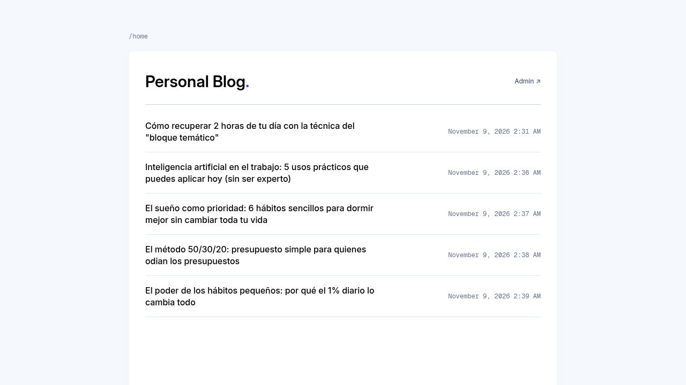
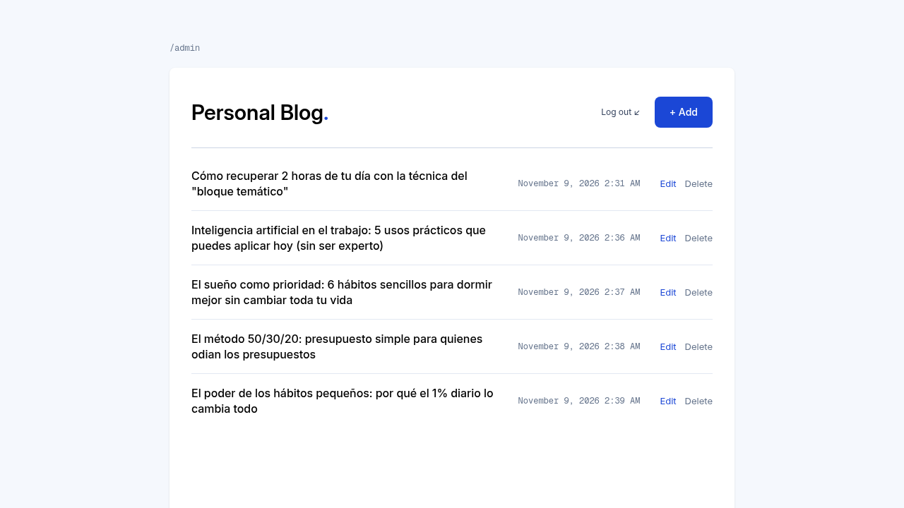
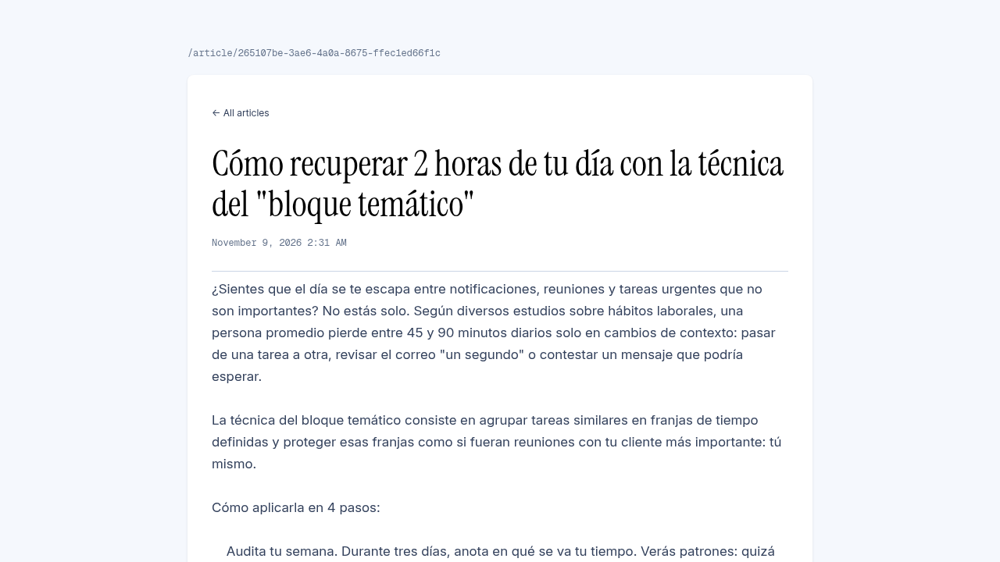

# Personal Blog

A small, self-hosted blog engine. Public readers browse a list of published articles; the owner signs in to create, edit, and delete them. Articles are persisted as a JSON file on disk, so there is no database to run.

## Screenshots

Public article list:



Admin panel, behind HTTP Basic auth:



Article view:



## Stack

| Layer | Choice | Version |
| --- | --- | --- |
| Language | Java | 25 |
| HTTP server | Javalin | 7.2.3 |
| Templates | JTE via `javalin-rendering-jte` | 3.2.4 |
| Serialization | Gson | 2.14.0 |
| Config | dotenv-java | 3.2.0 |
| Build | Maven | 3.9+ |

## Requirements

- JDK 25 (the POM compiles with `source`/`target` 25, and the entry point is a Java 25 implicit class).
- Maven 3.9+ for local builds. There is no Maven wrapper in the repository; the Docker build brings its own Maven.

## Configuration

Configuration is read from environment variables first, then from `config.env` in the working directory:

```bash
cp config.env.example config.env
```

| Variable | Read from | Required | Default |
| --- | --- | --- | --- |
| `PERSONAL_BLOG_USER` | environment, then `config.env` | yes | — |
| `PERSONAL_BLOG_PASSWORD` | environment, then `config.env` | yes | — |
| `CUSTOM_DIR` | environment, then `config.env` | no | `~/.personalblog` |
| `PORT` | environment only | no | `7070` |

- `config.env` is ignored by Git. Never commit real credentials.
- `PORT` is read with `System.getenv` only, so setting it in `config.env` has no effect.
- Credentials resolve as a pair: if either value is missing from the environment, both are taken from `config.env`.
- A relative `CUSTOM_DIR` is resolved against the working directory. `config.env.example` uses `./data`.

## Run locally

1. Create `config.env` as shown above and fill in the credentials.
2. Compile and launch from the repository root, so the app finds `config.env`:

```bash
mvn compile
mvn -q dependency:build-classpath -Dmdep.outputFile=/tmp/personal-blog-cp.txt
java -cp "target/classes:$(cat /tmp/personal-blog-cp.txt)" App
```

Open <http://localhost:7070>. The entry point is `App`, an implicit class in the default package; running `App.java` from your IDE works the same way.

JTE templates are compiled at build time, so `mvn compile` also generates them before the app starts. Running from the IDE produces the same precompiled output.

## Build

```bash
mvn clean package
```

This produces `target/personal-blog-1.0.0.jar` plus its runtime dependencies in `target/lib`. The jar declares `Main-Class: App` and a `Class-Path` entry pointing at `lib/`, so it starts on its own:

```bash
CUSTOM_DIR=./data PERSONAL_BLOG_USER=admin PERSONAL_BLOG_PASSWORD=change-me \
  java -jar target/personal-blog-1.0.0.jar
```

JTE templates are precompiled during the build by `jte-maven-plugin` into `target/classes/gg/jte/generated/precompiled`. The app renders them through `TemplateEngine.createPrecompiled(...)`, so the runtime never needs a compiler and no longer writes `jte-classes/`. There is no test source tree yet, so the build runs no tests.

Logging: `slf4j-simple` is declared at `runtime` scope, so `java -jar` prints Javalin and Jetty logs.

## Run with Docker

Two stages: `maven:3.9-eclipse-temurin-25` builds the runnable jar and `eclipse-temurin:25-jre` runs it as the unprivileged `app` user.

```bash
docker build -t personal-blog .
docker run -d --name personal-blog \
  -p 7070:7070 \
  -e PERSONAL_BLOG_USER=admin \
  -e PERSONAL_BLOG_PASSWORD=change-me \
  -v personal-blog-data:/data \
  personal-blog
```

`CUSTOM_DIR` defaults to `/data` in the image and `/data` is a declared volume, so articles survive `docker rm` while the volume exists. `PORT` defaults to `7070` and `EXPOSE` matches it. `JAVA_TOOL_OPTIONS` sets `MaxRAMPercentage=75` and `ExitOnOutOfMemoryError`. The `HEALTHCHECK` opens a TCP connection to the app port; it requires the image built with the `docker` format, since Podman drops it for OCI images.

Credentials come from the environment; `config.env` is not copied into the image and is excluded by `.dockerignore`.

## Routes

Public:

| Method | Path | Purpose |
| --- | --- | --- |
| `GET` | `/` | Redirects to `/home` |
| `GET` | `/home` | Article list |
| `GET` | `/home/article/{id}` | Single article |

Admin (requires HTTP Basic auth):

| Method | Path | Purpose |
| --- | --- | --- |
| `GET` | `/admin` | Article list with edit and delete links |
| `GET` | `/admin/article/{id}` | Article preview |
| `GET` | `/admin/new` | New article form |
| `POST` | `/admin/create` | Create an article |
| `GET` | `/admin/edit/{id}` | Edit form |
| `POST` | `/admin/update/{id}` | Update title, content, and publish date |
| `GET` | `/admin/delete/{id}` | Delete an article |

Static assets live on the classpath under `static/`; Javalin mounts that directory at the root, so templates link `/normalize.css`, `/styles.css`, and `/fonts/...`.

A malformed or unknown id surfaces as an uncaught domain exception and renders `500` (for example `/home/article/abc`). There is no custom `404` or error page yet.

## Data storage

`Storage` keeps a single JSON array in `articles_data.json` inside `CUSTOM_DIR`. The directory and file are created on first start with `[]`. Every write (`insert`, `update`, `delete`) rewrites the whole array, with no locking or atomic replace, so run a single instance against a given directory.

An article is a record of `id` (`UUID`), `title`, `content`, and `publishedAt` (`LocalDateTime`). Its compact constructor rejects a null `id`, a blank `title` or `content`, and a null or future `publishedAt`, then strips both text fields. Failures throw `ArticleValidationException`.

Gson serializes `publishedAt` with its reflective date/time shape, so the file looks like this:

```json
[
  {
    "id": "a9e21038-8624-44f9-b980-0856db713bc4",
    "title": "Hello",
    "content": "World",
    "publishedAt": {
      "date": { "year": 2026, "month": 11, "day": 11 },
      "time": { "hour": 1, "minute": 16, "second": 50, "nano": 826806870 }
    }
  }
]
```

Editing a publish date goes through the `publish_date` form field, which uses `yyyy-MM-ddTHH:mm`, the same format `Article#getFormattedPublishedAt` renders.

## Project structure

```
src/main/java/io/github/vekzzdev/personalblog/
├── App.java                     entry point in the default package: static files, JTE, auth, routes
├── Article.java                 domain record with compact-constructor validation
├── ArticleService.java          use cases over the stored articles
├── Storage.java                 JSON file read/write and directory resolution
├── BasicAuth.java               HTTP Basic authentication for the admin area
├── HomeController.java          public routes
├── AdminController.java         admin routes
└── exception/                   domain and storage error types

src/main/resources/
├── static/                      normalize.css, styles.css, self-hosted fonts
└── templates/                   JTE pages, one per view
    └── html/                    static HTML mockups, not served and excluded from the Docker build
```

`pom.xml`, `Dockerfile`, and `config.env.example` sit at the repository root.

## Security note

`BasicAuth` compares the request's Basic credentials with `PERSONAL_BLOG_USER` / `PERSONAL_BLOG_PASSWORD` on every request, and answers `401` with a `WWW-Authenticate: Basic` header on mismatch.

It is registered as `beforeMatched` handlers for `/admin/` and `/admin/*`, so the dashboard and every subroute require credentials. Both patterns stay in sync with the route table: an admin path registered outside `/admin` would need its own handler.

Two limits remain: delete is a `GET`, so a browser that already holds Basic credentials can be tricked into deleting an article from another site (there is no CSRF token), and Basic credentials are base64 over plain HTTP, so put a TLS proxy in front of anything that is not localhost.

## License

Released under the MIT License. See [LICENSE](LICENSE).
